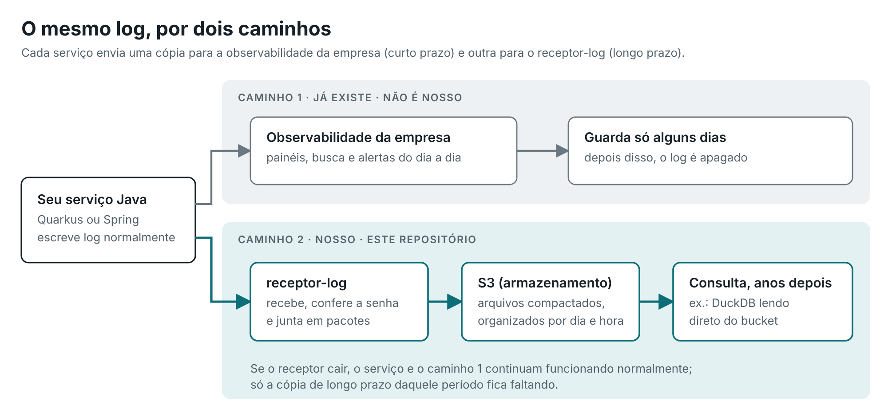
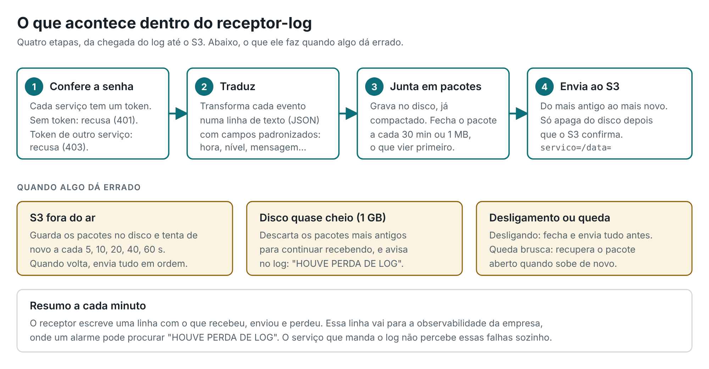

# receptor-log

**Guardar os logs dos seus serviços Java por anos, num bucket S3, sem mexer na observabilidade que a empresa já tem.**

> **Em uma frase:** cada serviço passa a mandar uma cópia do próprio log para um serviço nosso, o receptor-log, que
> junta essas mensagens em arquivos compactados e os guarda no S3.



## Para quem não é da área

**O que é um log?** É o "diário" de um sistema. Cada vez que algo acontece ("pedido 123 recebido", "falha ao falar com
o banco de dados"), o programa escreve uma linha. Quando dá problema, é nesse diário que se descobre o que houve.

**Qual é o problema?** Muitas empresas têm uma ferramenta de observabilidade (painéis, buscas e alertas sobre esses
logs) que guarda tudo por pouco tempo, alguns dias, porque guardar mais sai caro. Mas às vezes é preciso consultar o
que aconteceu meses ou anos atrás: uma auditoria, uma reclamação antiga, um erro que só agora foi percebido.

**O que este projeto faz?** Cria um **segundo caminho** para o log. O primeiro caminho, o da empresa, continua
exatamente como está. O segundo leva uma cópia para o **S3**, um tipo de armazenamento barato e durável (pense num
"HD na nuvem" feito para guardar muitos arquivos por muito tempo).

**Por que não usar a ferramenta da empresa?** Porque ela é de outro time. Este projeto foi pensado para não depender
de ninguém de fora: o time dono dos serviços instala e cuida de tudo sozinho.

## O que tem neste repositório

| Pasta | O que é |
|:--|:--|
| [`receptor-log/`](receptor-log/) | **O coração do projeto.** Um serviço que recebe os logs, organiza em arquivos e envia ao S3 |
| [`modelo-quarkus-pokemon/`](modelo-quarkus-pokemon/) | Um serviço de exemplo (cadastro de pokémons) já configurado para mandar o log pelos dois caminhos |
| [`modelo-batch-wikipedia/`](modelo-batch-wikipedia/) | Um serviço de exemplo em Spring Batch (tarefa agendada). **Ainda não** manda pelo segundo caminho |
| [`playground/`](playground/) | Peças "de mentira" para rodar tudo na sua máquina: um S3 falso e um coletor que imita a observabilidade da empresa |
| [`docs/`](docs/) | Guia de uso, decisões e roadmap |

## Por onde começar

| Quero… | Leia |
|:--|:--|
| Ver funcionando na minha máquina | [Guia de uso → Parte 1: o playground](docs/USO.md#parte-1--rodar-tudo-na-sua-máquina-playground) |
| Ligar o segundo caminho num serviço meu | [Guia de uso → Parte 2](docs/USO.md#parte-2--ligar-o-segundo-caminho-num-serviço) |
| Entender por que foi feito assim | [Decisões](docs/DECISOES.md) |
| Saber o que já está pronto e o que falta | [Roadmap](docs/ROADMAP.md) |
| Detalhes técnicos do receptor | [`receptor-log/README.md`](receptor-log/README.md) |

## Como o receptor funciona por dentro



Os logs chegam, o receptor confere a "senha" (token) de quem enviou, transforma cada evento numa linha de texto
padronizada, junta as linhas em pacotes compactados e manda os pacotes para o S3. No bucket, os arquivos ficam
organizados assim:

```
servico=modelo-quarkus-pokemon/
  data=2026-10-14/
    20261014T130000123Z-receptor-log-7c9f-1.jsonl.gz
    20261014T133000456Z-receptor-log-7c9f-2.jsonl.gz
```

Ou seja: uma pasta por serviço e, dentro dela, uma por dia (em horário UTC). O nome de cada arquivo começa pela data e
hora em que ele foi aberto, então a lista de um dia já sai em ordem cronológica. Ferramentas como
DuckDB, Athena e Trino conseguem consultar esses arquivos direto no bucket, sem precisar importar nada.

## Situação atual

- ✅ **Receptor completo:** recebe, guarda no disco, envia ao S3, aguenta o S3 fora do ar, não estoura o disco,
  desliga sem perder o que tinha e exige token por serviço. 53 testes automáticos.
- ✅ **Serviços Quarkus:** o segundo caminho funciona (exemplo no `modelo-quarkus-pokemon`, 11 testes).
- ⏳ **Serviços Spring:** ainda falta.
- ⏳ **Mascarar dados pessoais** antes de gravar: é o último passo, e **nenhum dado real deve passar por aqui antes
  dele**.

Detalhes no [roadmap](docs/ROADMAP.md).

## Tecnologias

Java 17 · [Quarkus](https://quarkus.io) 3.33 · [OpenTelemetry](https://opentelemetry.io) (o padrão aberto para
enviar logs) · AWS SDK v2 (S3) · Spring Boot 3.5 / Spring Batch (no exemplo). Para rodar só é preciso o **JDK 17 ou
mais novo**; cada projeto traz o próprio Maven (`mvnw`).
