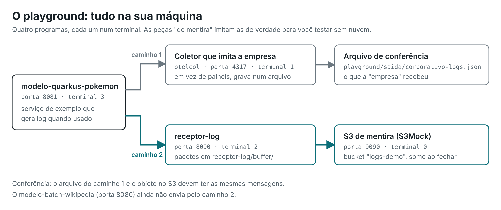

# playground

Peças para rodar a arquitetura inteira na sua máquina, sem nuvem e sem cluster.

| Arquivo | Papel no playground | No ambiente real, equivale a |
|:--|:--|:--|
| `coletor-corporativo.yaml` | Configuração de um OpenTelemetry Collector que **imita a observabilidade da empresa**: recebe na porta 4317 e grava em `saida/` | O coletor e as ferramentas de observabilidade da empresa |
| `otelcol` / `otelcol.exe` | O programa do coletor (baixado no passo 0, não fica no repositório) | — |
| `s3mock.jar` | **S3 de mentira** na porta 9090 (baixado no passo 0, não fica no repositório) | O S3 de destino |
| [`insomnia/`](insomnia/) | Corpos OTLP prontos para chamar o `/v1/logs` na mão (Insomnia, Postman, curl) | Um serviço mandando log |

## Portas

| Porta | Quem |
|:--|:--|
| 4317 | Coletor que imita a empresa |
| 8080 | modelo-batch-wikipedia |
| 8081 | modelo-quarkus-pokemon |
| 8090 | receptor-log (no playground; o padrão é 8080, que colide com o wikipedia) |
| 9090 | S3Mock |

## Como rodar

O passo a passo completo, com os testes de falha, está no
[guia de uso](../docs/USO.md#parte-1--rodar-tudo-na-sua-máquina-playground).
